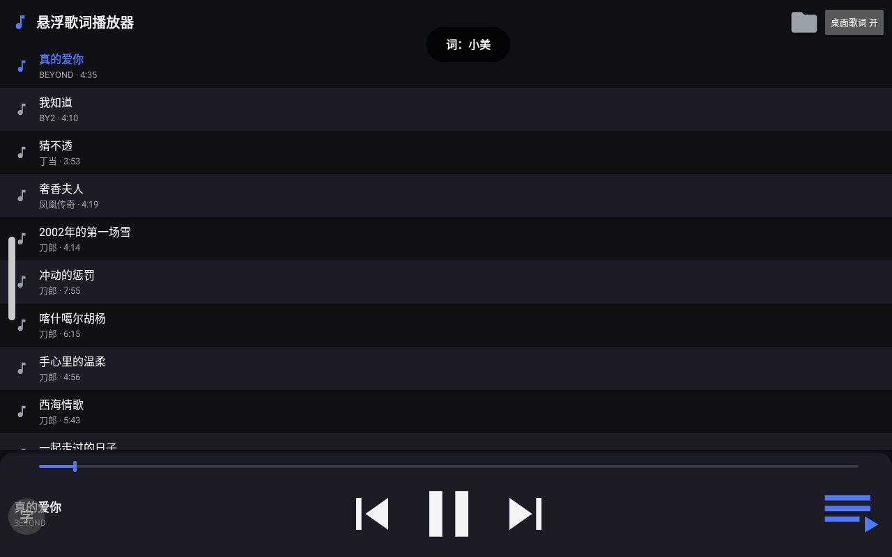
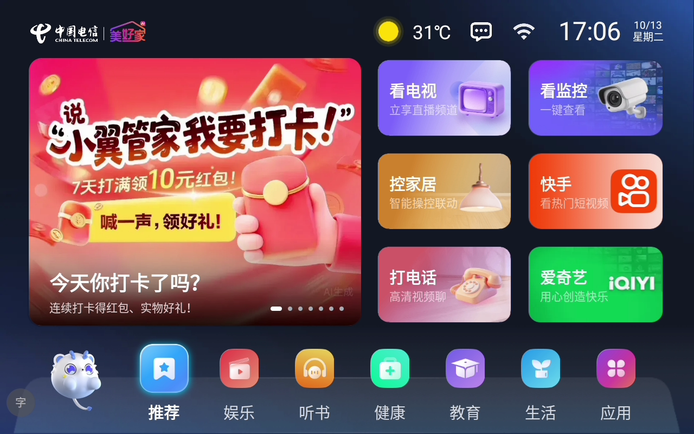

# LyricPlayer · 悬浮歌词音乐播放器

极简 Android 本地音乐播放器，主打**顶层悬浮歌词**：歌词悬浮在所有应用之上、随播放逐句滚动，退出应用、切桌面、锁屏依然跟随。

在 Android 9 电视盒与 Android 10 手机上真机开发与验证，尤其适配**系统媒体扫描损坏的设备**（部分电视盒/运营商定制机）。




## 下载体验

直接下载 [apk/LyricPlayer-v1.17.apk](apk/LyricPlayer-v1.17.apk) 安装（debug 签名）。

- 最低支持 Android 7.0（API 24），兼容至 Android 14（API 34）
- 手机/平板/电视盒自适应：窄屏紧凑布局，宽屏（≥600dp）三段式大按钮布局，电视遥控器可操作

## 功能总览

**播放**
- 双源音乐库：系统 MediaStore + 文件系统直扫（Music/song/Download 等目录，含 U 盘）合并去重，媒体扫描损坏的设备也能秒刷出新歌
- ID3 标签补全：直扫曲目自动读取文件内嵌的歌手/时长，列表显示与手机媒体库一致
- 四种播放模式：顺序 / 单曲循环 / 列表循环 / 随机
- 上一首/下一首（上一首双语义：播放超 3 秒回本曲开头，否则回上一曲）
- 应用内进度条：查看/拖动跳转，歌词同步跳句
- 系统播控（MediaSession）：下拉控制中心、通知栏媒体卡片、锁屏播控、耳机线控、蓝牙耳机全部可控制播放/上下曲/进度
- 音频焦点：来电/其他应用抢声音自动暂停、焦点归还自动恢复、短时提示音自动闪避
- 拔耳机/断开蓝牙自动暂停
- 状态记忆：播放模式、桌面歌词开关、悬浮窗位置、播放队列与进度——重启应用点播放即从上次位置继续

**歌词**
- 顶层桌面歌词：默认屏幕顶部居中，拖动移位（位置持久化），单击打开 App，长按暂停/继续；无歌词时显示歌名
- `.lrc` 解析：`[mm:ss]` / `[mm:ss.xx]` / 一行多时间标签，二分查找当前行
- 编码自动识别：UTF-8 / UTF-8 BOM / UTF-16 / GBK / GB2312，国内常见 GBK 歌词不乱码

**浏览与管理**
- 主列表：斑马条纹、当前曲目自动滚动定位 + 主题蓝高亮、后台线程加载
- 文件夹浏览：从存储列表（本机存储/U 盘）直达选歌；点击播放整个文件夹、长按文件夹直接播放、底部"播放全部"按钮
- 删除文件：主列表或文件夹页长按音频文件，确认后删除（含媒体库记录）
- 通知栏：前台服务保活 + 播放/暂停/关闭操作

## 从源码构建

- 环境：Android Studio（Hedgehog 或更新）+ JDK 17，SDK Platform 34
- 用 Android Studio 打开本项目，Gradle Sync 后直接 Run
- 或命令行：`gradlew assembleDebug`，APK 输出在 `app/build/outputs/apk/debug/`

## 首次使用的权限

| 权限 | 用途 | 时机 |
|---|---|---|
| 音乐和音频 / 存储读取 | 扫描本地音乐 | 启动时申请 |
| 显示在其他应用上层 | 顶层悬浮歌词 | 点「桌面歌词」开关时跳转系统设置 |
| 通知 | 播放通知（拒绝不影响播放） | Android 13+ 随启动申请 |

## 歌词文件规则

与歌曲**同目录、同名**（忽略大小写），扩展名 `.lrc`：

```
/sdcard/Music/晴天.mp3
/sdcard/Music/晴天.lrc
```

## 代码结构

```
app/src/main/java/com/mini/lyricplayer/
├── App.kt               # Application：初始化播放器、恢复上次会话、注册悬浮歌词
├── MainActivity.kt      # 主界面：列表/进度条/播控/删除/高亮定位
├── FolderActivity.kt    # 文件夹浏览（本机存储/U盘，不依赖媒体扫描）
├── MusicRepository.kt   # 双源扫描 + ID3 标签读取补全
├── MusicService.kt      # 前台服务：保活 + 播放通知
├── PlayerManager.kt     # 单例播放器：队列/播放模式/进度轮询/焦点/MediaSession/持久化
├── LrcParser.kt         # .lrc 多编码解析 + 当前行二分查找
└── LyricOverlay.kt      # WindowManager 顶层悬浮歌词
```

## 真机测试记录

在 Android 9 电视盒（Amlogic 方案）与 Android 10 手机（P30 Pro）上完成主要功能验证：播放、歌词时间轴（7.8s 精确命中对应句）、悬浮窗置顶与交互、U 盘选歌、系统播控/媒体键、进度条像素级吻合、杀进程重启续播、音频焦点日志等。

部分运营商定制盒子的后台清理器会无视前台服务杀死后台应用（属设备侧限制），长期挂后台请在设备的"电视管家/自启动管理"中加白名单。

## 已知限制（有意保持极简）

- 无在线歌词匹配、不读取 MP3 内嵌歌词（USLT/SYLT）
- 歌词样式（字号/颜色）固定，无设置页
- Android 13+ 上删除非本应用创建的文件受系统限制，可能失败
